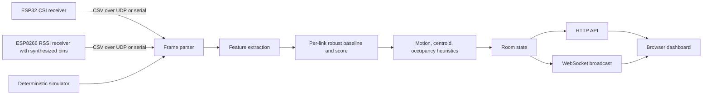
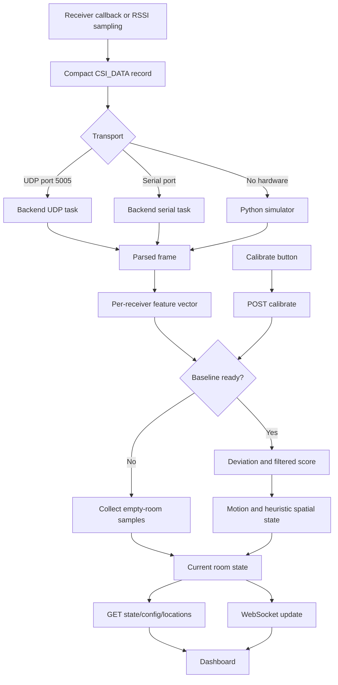

# Wi-Fi RF Room Monitor: System Architecture and Implementation Review

## A research-style technical report on CSI and RSSI sensing, firmware, backends, and dashboard

**Project examined:** Deep Basics Monitor / RuView Observatory  
**Repository review date:** 7 October 2026  
**Report type:** Code-based system study  

---

## Abstract

This report examines a room-monitoring prototype that uses changes in Wi-Fi radio measurements to infer motion and rough spatial activity. The repository combines two server implementations, a browser visualization, configurable room geometry, and embedded receiver firmware. The Python implementation is the one documented by the README and contains simulation, serial and UDP ingestion, robust empty-room calibration, feature extraction, and heuristic motion and occupancy estimation. A parallel Rust implementation exposes a similar dashboard API and a separate inference pipeline. The ESP32 firmware captures Channel State Information (CSI), while the ESP8266 firmware emits RSSI-based records with synthesized spectral values. The front end renders a Three.js room scene and visualizes server state.

The main finding is that this is a signal-processing prototype, not a machine-learning pose-estimation system. The repository contains no trained model weights, model runtime, labeled training dataset, or evaluation protocol. Dashboard elements that imply DensePose, 17-keypoint pose, vital signs, accuracy, or clinical monitoring are not backed by those measurements in the processing pipeline. Reported coordinates and occupant counts should therefore be treated as illustrative estimates. The project is useful as a foundation for experimenting with RF sensing and live telemetry, but it requires protocol unification, validated spatial calibration, evidence-based evaluation, and clearer UI claims before it can support reliable people tracking.

**Keywords:** Wi-Fi sensing, Channel State Information, RSSI, robust baseline, embedded systems, real-time dashboard, occupancy inference

---

## 1. Introduction

### 1.1 Background

Wi-Fi Channel State Information describes how a received radio signal varies across the subcarriers of a wireless channel. A change in the environment, including a moving person, can alter the multipath signal observed by a receiver. Received Signal Strength Indicator (RSSI) is a coarser measurement of received power. Both can provide indirect evidence of environmental change, but neither is an image. Estimating location, count, posture, or vital signs requires a sensing method, calibration, and validation appropriate to each output.

### 1.2 Project objective and scope

The project presents a privacy-oriented, CCTV-style interface for RF-based motion monitoring. Its implemented pipeline receives records from software simulation, serial-attached hardware, and UDP-connected receivers; derives features from RSSI and IQ samples; compares observations with a baseline; then streams a room-state object to the browser.

This report describes what is present in the repository. It does not treat labels, comments, sample percentages, or product copy as experimental evidence. It also distinguishes the Python and Rust programs because they are separate implementations and do not currently have identical processing behavior.

### 1.3 Main contributions of the prototype

1. A compact CSI record format and parser for receiver streams.
2. A robust median/MAD empty-room baseline and per-frame signal features.
3. A real-time room state API delivered over HTTP and WebSocket.
4. A browser dashboard with a configurable 3D room, sensor indicators, histories, and event/status panels.
5. Firmware scaffolding for an ESP32 CSI receiver and an ESP8266 RSSI-oriented receiver.

---

## 2. Project inventory and implementation status

| Layer | Main files | Technology | Observed role |
|---|---|---|---|
| Python service | `app/main.py` | Python, FastAPI, Uvicorn | README-supported application entry point; REST and WebSocket API; source selection |
| Python signal pipeline | `app/processor.py`, `app/parser.py`, `app/models.py` | Python | CSI/RSSI features, calibration, motion score, heuristic occupant display |
| Native service | `src/main.rs`, `src/server.rs` | Rust, Tokio, Axum | Parallel native service; UDP/serial collection and dashboard API |
| Native processing | `src/signal.rs`, `src/spatial.rs`, `src/csi.rs` | Rust | Similar feature extraction and robust baseline with different tuning/logic |
| Browser | `web/index.html`, `web/app.js`, `web/style.css` | HTML, CSS, JavaScript, Three.js r128 | 3D WebGL scene, HUD, chart canvases, state rendering |
| ESP32 firmware | `firmware/esp32-csi-receiver/main/main.cpp` | Arduino framework with ESP-IDF Wi-Fi APIs | Receives CSI callbacks, serializes records, transmits serial and UDP |
| ESP8266 firmware | `firmware/esp8266-rssi-receiver/main/main.cpp` | Arduino ESP8266 | Samples Wi-Fi RSSI and synthesizes record values for transport compatibility |
| Room config | `config/room.json` | JSON | Room dimensions, receiver/link coordinates, threshold and calibration count |
| Tests | `tests/test_core.py` | Python `unittest` | Parser, robust baseline, calibration, and feature dimension checks |

The README documents the Python app and `requirements.txt` lists its runtime dependencies. `Cargo.toml` defines a second Rust executable with its own API and processing code. The two are best understood as alternate engines sharing a dashboard contract, rather than as one Python frontend/backend stack where Rust is a library. The README does not explain how to choose between them.

### 2.1 Runtime dependencies and named models

| Name | Present in code? | What it actually does |
|---|---|---|
| `RobustBaseline` | Yes, Python and Rust | Stores baseline feature samples; computes per-feature median and a scaled median absolute deviation (MAD); returns a normalized deviation score |
| `frame_features` / `extract_frame_features` | Yes | Converts IQ pairs to magnitudes, smooths, pools to 12 bins, normalizes amplitudes, and prefixes RSSI |
| Motion envelope / asymmetric score filter | Yes | Smooths the deviation score with faster attack and slower release |
| Occupancy count heuristic | Yes, both engines with different constants | Maps signal energy to an integer count using a hand-coded formula, then holds/damps decreases |
| Position / activity heuristic | Yes | Uses sensor coordinate weights and fixed room layouts/anchors to produce rough displayed positions and activity labels |
| DensePose / pose-estimation ML model | **No** | No model architecture, trained weights, inference library, labeled dataset, or actual keypoint output path is present |
| Heart-rate / respiration model | **No** | No physiological signal extraction or rate estimation is present; dashboard values are static UI defaults |
| Scikit-learn, PyTorch, TensorFlow, ONNX | **No** | None appears in runtime dependencies or project source |

“Model” in the code therefore refers to data structures and heuristic signal models, not learned AI models. The source contains no demonstrated person identification or reliable multi-person tracking model.

---

## 3. System architecture

### 3.1 High-level flow



### 3.2 Data and control paths



The diagrams describe the repository’s intended flows. The exact transport/source combinations differ by backend. The Rust application starts UDP and discovered or configured serial sources together. The Python app supports `simulate`, `serial`, `udp`, and `auto`/hybrid modes.

---

## 4. Hardware and embedded data acquisition

### 4.1 ESP32 CSI receiver

The ESP32 firmware initializes station-mode Wi-Fi, disables power-save, configures CSI collection through ESP Wi-Fi APIs, and registers a CSI receive callback. For each callback it formats receiver ID, device uptime in milliseconds, source MAC, RSSI, noise floor, channel, declared CSI length, and byte values into a CSV-like `CSI_DATA` record. A FreeRTOS queue moves records from the callback to the main loop, which writes records to serial and forwards them as UDP datagrams. A periodic `PING` datagram is also emitted.

The configured UDP destination and Wi-Fi settings are currently compiled into firmware source. This report intentionally does not repeat the credential values. Move secrets and deployment-specific addresses into excluded configuration before sharing or flashing broadly. The record timestamp is `millis()` (uptime), while the README’s example calls the field Unix milliseconds; consumers should not assume wall-clock timestamps.

### 4.2 ESP8266 receiver

The ESP8266 firmware samples `WiFi.RSSI()` at roughly 20 Hz. It constructs the common record shape but derives 16 numeric values from the difference between current RSSI and a smoothed prior RSSI. Those values are synthetic bins, not CSI IQ measurements. It sends records to serial and UDP. The processor therefore receives compatible-looking numeric vectors from a sensor with different physical meaning.

### 4.3 Record format

The compact project record is:

```text
CSI_DATA,receiver_id,timestamp,source_mac,rssi,noise_floor,channel,declared_length,value0,value1,...
```

The Python parser expects this compact form and rejects short payloads relative to the declared value count. The Rust parser accepts JSON, the project compact CSV form, and a legacy Espressif-style CSV interpretation. The Rust custom CSV detection checks receiver IDs beginning with `receiver`; that is narrower than the Python parser’s general nonnumeric receiver field. Rust also casts/collects into signed 8-bit IQ values, whereas Python keeps integer values. Protocol behavior should be unified and validated against captured device records.

### 4.4 Room geometry

`config/room.json` sets the room to 5.0 m by 4.0 m, calibration to 10 samples, and the motion threshold to 0.35. Two configured links are placed near opposite corners. Room dimensions and link coordinates should correspond to actual measurements; the processing code also contains hard-coded receiver positions and desk anchors, so editing JSON alone does not fully relocate all spatial assumptions.

---

## 5. Signal processing and inference

### 5.1 Feature extraction

For IQ pairs \((I_k,Q_k)\), the feature extractor computes magnitude:

\[
 a_k = \sqrt{I_k^2 + Q_k^2}.
\]

If there are at least three magnitudes, a three-value median window smooths adjacent bins. The sequence is pooled into 12 groups. A median amplitude is subtracted in absolute distance, divided by the mean amplitude (with a floor), and multiplied by 12. RSSI is prepended, producing a 13-value feature vector. Empty IQ data falls back to RSSI plus zero-filled bins.

This is a magnitude-focused representation. It discards phase information, which can carry useful CSI structure, and aggregates away much of the subcarrier detail. The inline comments describe acoustic/speaker rejection, but the code only applies spectral medians and common-mode amplitude normalization; it does not identify or prove acoustic source cancellation.

### 5.2 Robust baseline

During calibration, the system stores a configured number \(N\) of feature vectors. For each feature dimension \(j\), it computes the median center \(m_j\) and scale:

\[
 s_j = \max(1.4826 \cdot \operatorname{median}(|x_{ij}-m_j|), f_j),
\]

where the floor \(f_j\) is 1.4 for RSSI and 0.75 for spectral features. The normalized deviation for a frame is based on \(|x_j-m_j|/s_j\), taking the mean of the largest half of active dimensions and clipping the result. This reduces sensitivity to outliers compared with a mean/standard-deviation baseline.

The Python baseline is fixed after it has collected the target sample count. The Rust baseline then adapts its center over time. Consequently, prolonged environmental changes may be treated differently by the two engines.

### 5.3 Motion score and state

Per-link scores use an asymmetric exponential filter: rises are weighted more strongly than falls. A second envelope follows combined energy with a faster attack and slower release. The configured threshold produces `motion`, `still`, or `calibrating` states (plus `offline` after an inactivity timeout). Confidence is a normalized function of the summed link weights, capped below 1.0. It is a heuristic score, not a statistically calibrated probability.

The Python engine combines maximum and sum of active link scores to obtain energy. The Rust engine chooses `receiver-1` when available, otherwise `receiver-2`, for motion energy, even though its location weighting uses all calibrated links. This difference means equivalent inputs can produce different states and counts.

### 5.4 Occupancy and spatial estimates

Both implementations turn signal energy into an integer occupancy estimate with hard-coded constants and temporal hold logic. Python uses a nominal per-person increment of 0.58 energy units. Rust uses 1.28 units and describes an ESP32-specific occupancy relation. Neither constant is accompanied by collected training data, a calibration study, or an accuracy evaluation in the repository.

Position is approximated by a weighted centroid of configured link coordinates. Multiple displayed people are then placed using fixed room points/anchors and smoothed over time. The multi-person layout is not a reconstruction of separately measured human positions. Activity labels such as “Walking” and “Typing / Seated” follow distance thresholds between heuristic anchor positions. The simulator has known synthetic paths, but real-hardware inputs do not provide ground-truth people positions.

---

## 6. Backend implementations

### 6.1 Python / FastAPI implementation

`app/main.py` loads room JSON, creates a `Runtime`, starts the selected asynchronous source iterator, updates `RoomProcessor`, broadcasts state to connected WebSockets, serves static assets, and exposes:

| Endpoint | Method | Purpose |
|---|---|---|
| `/` | GET | Dashboard HTML |
| `/api/state` | GET | Latest room state |
| `/api/locations` | GET | Simplified occupant and centroid view |
| `/api/config` | GET | Room config plus source/network metadata |
| `/api/wifi-scan` | GET | Network scan via `nmcli`, with hard-coded fallback entries |
| `/api/people-count` | POST | Changes simulator population (0–3) |
| `/api/calibrate` | POST | Clears baselines and restarts calibration |
| `/ws` | WebSocket | Pushes initial state and subsequent snapshots |

The implementation offers deterministic synthetic motion paths and seeded noise for a repeatable demonstration. In `auto`/hybrid mode it listens for UDP and optionally starts serial readers; if hardware does not provide frames for six seconds, it emits offline state. The `nmcli` subprocess call currently passes `capture_args=False`, which is not a valid `subprocess.run` parameter; the exception is swallowed and the static fallback list is returned. Thus the intended live scan is not functional in the current source.

### 6.2 Rust / Tokio / Axum implementation

`src/main.rs` loads `RoomConfig`, starts a bounded multi-producer/single-consumer frame channel, launches UDP and serial ingestion tasks, and runs a processing event loop. `src/server.rs` defines Axum routes for dashboard, state, locations, config, a Wi-Fi scan response, calibration, and WebSocket updates. Shared state uses Tokio `RwLock`; WebSocket clients subscribe through a Tokio broadcast channel.

The Rust `/api/wifi-scan` endpoint returns a fixed list of sample networks rather than scanning the environment. The native API does not expose the Python simulator or `/api/people-count` route. Rust CORS is configured to allow any origin, method, and header. That setting is convenient during development but should be narrowed for a deployed instance. The Rust source is an alternate implementation, not a dependency of FastAPI.

### 6.3 Concurrency and backpressure

Python uses asyncio queues and per-client WebSocket sends. Rust uses a bounded frame channel of 1,000 entries and a broadcast channel of 256 room states. Rust send errors for ingestion frames are ignored. A production design should define queue overflow policy, report dropped/invalid frames consistently, and isolate slow WebSocket clients so processing remains observable under load.

---

## 7. Frontend and user interface

### 7.1 Stack and display

The UI is static HTML/CSS/JavaScript. Three.js r128 and OrbitControls are loaded from public CDNs; Inter and JetBrains Mono fonts are loaded from Google Fonts. The JavaScript fetches `/api/config`, opens `/ws`, and renders incoming JSON state. Three.js builds a room floor, grid, receiver markers, particle cloud, and skeleton-like figures. Separate canvas routines draw signal heatmaps, link sparklines, and a disturbance timeline.

### 7.2 Data-driven and decorative elements

The room dimensions, configured link positions, state counts, centroid, score histories, RSSI, and motion energy are connected to backend data. In contrast, the following visible claims are hard-coded or presentation-only in the checked-in UI/code:

- Heart rate and respiration display values are static defaults; no API field or estimator updates them.
- “DensePose,” “17-Keypoints,” and “PCK@20 92.9%” are labels/defaults, not model outputs or measured accuracy.
- The front-end skeleton joint positions are generated from fixed geometry and a small periodic animation; they are not inferred from CSI pose landmarks.
- Scenario choices include fall detection, sleep monitoring, gestures, search and rescue, and vital signs, but no corresponding server-side classifier or scenario engine is present.
- FPS is displayed as a fixed “60 FPS” label in HTML rather than a measured performance value.
- The WebSocket open handler labels the source “LIVE HARDWARE” even for simulation.

These interface details can mislead users about the sensor’s capabilities. They should be relabeled as illustrative mock data or removed until supported by real inference and evaluation.

### 7.3 Dashboard interactions

The three view buttons switch camera presentation modes, and settings offer visual effects such as rendering style, particle density, and glow. The recalibration button sends `POST /api/calibrate`. Controls for pose mode, acoustic cancellation, and scenario selection are primarily visual settings; the current server protocol does not implement corresponding model or signal-mode changes.

---

## 8. Data handling, privacy, and security

The stated intent is to infer RF disturbance without camera pixels. The frame schema nevertheless contains source MAC addresses, and the firmware emits them. MAC addresses are device identifiers and should be removed, randomized, or short-lived hashed if not required for a documented function. The system has no persistent database in the inspected code, but network and console logs can still expose records and configuration.

The services bind to `0.0.0.0` by default, and the Rust API permits broad CORS. No application authentication or transport encryption is implemented in the examined source. The dashboard loads scripts and fonts from third-party CDNs. These choices are suitable only for a controlled development network unless deployment protections are added.

The README correctly cautions that inferred location is uncertain and that the project should not be used as a life-safety, security, or medical system. The interface should consistently communicate consent, uncertainty, and whether data is simulated or hardware-derived.

---

## 9. Validation and reproducibility

The checked-in tests cover four basic behaviors: compact CSV parsing, rejection of short CSI payloads, baseline sensitivity to a changed feature, calibration readiness, and a feature vector length check. They do not establish spatial accuracy, motion detection sensitivity, occupancy count accuracy, latency, robustness across rooms, or vital-sign/pose performance.

The simulator uses deterministic random noise and formula-based trajectories. This is useful for interface development and basic pipeline exercise, but simulator results are not evidence of real-world accuracy. A meaningful evaluation would require synchronized ground truth, multiple subjects and room layouts, empty-room and occupied-room sessions, repeated placements, environmental changes, and a held-out test protocol.

This report was produced by source inspection. It does not report benchmark results or claim that hardware was connected during review.

---

## 10. Limitations and engineering risks

1. **No learned model or ground truth.** Position, occupant count, and activity labels are rules and anchors; there is no supervised estimator.
2. **Python/Rust divergence.** They differ in energy aggregation, baseline adaptation, receiver parsing, scaling, endpoint behavior, and count constants.
3. **Mixed sensor semantics.** The ESP32 emits CSI-derived bytes; the ESP8266 emits RSSI-derived synthetic bins. Shared features do not make them equivalent sensors.
4. **Hard-coded room assumptions.** Receiver coordinates, room regions, and workstation positions appear in processing code in addition to JSON configuration.
5. **Calibration weakness.** A handful of samples may not characterize environmental variability; calibration relies on users keeping the room empty and stable.
6. **UI overclaim.** Pose, biometric, scenario, and accuracy elements exceed the implemented backend capabilities.
7. **Protocol ambiguity.** Firmware uptime is labeled like Unix time in documentation; parsers accept different layouts and differ in length handling.
8. **Operational security.** Firmware source contains credentials and endpoint values; API access and CORS are not production-hardened.
9. **Dependency delivery.** The dashboard depends on external CDNs and has no local asset fallback.
10. **Monitoring observability.** Invalid records and queue drops are not counted or surfaced consistently across implementations.

---

## 11. Recommended development roadmap

### Phase A — establish a truthful baseline

- Select Python or Rust as the supported runtime, or document a compatibility contract and maintain both deliberately.
- Correct the Python Wi-Fi scan subprocess arguments; make Rust scan behavior clearly labeled as unavailable or implement a real scan.
- Remove static pose/vitals/accuracy claims and mark simulator versus hardware source explicitly.
- Move device credentials and network destinations into local, ignored configuration.
- Define one versioned frame schema with timestamp units, signedness, receiver ID rules, and record validation.

### Phase B — characterize the sensor

- Collect repeated CSI/RSSI recordings with synchronized ground-truth labels.
- Track room geometry, access point, channel, antenna placement, receiver firmware, and calibration conditions.
- Measure false positive rate, detection rate, count error, localization error in meters, latency, and dropped-frame rate.
- Evaluate each receiver type separately before combining them.

### Phase C — build evidence-based inference

- Start with clear baselines (RSSI threshold, CSI feature threshold, classical classifier/regressor) and compare them under a held-out split by session/room.
- Add a learned pose or physiological model only if the data, sensor configuration, and target metrics support it.
- Report uncertainty and abstain when inputs fall outside calibrated conditions.
- Keep identification out of scope unless a separate justified, consented design requires it.

### Phase D — harden deployment

- Bind to localhost by default or protect LAN access with authentication and TLS at a reverse proxy.
- Restrict CORS, minimize MAC retention, and document collection/deletion behavior.
- Bundle static assets or pin and integrity-check remote dependencies.
- Add structured health, malformed-frame, queue-pressure, and receiver-offline metrics.

---

## 12. Conclusion

Deep Basics Monitor is a substantial prototype spanning embedded acquisition, signal processing, asynchronous server design, and 3D visualization. Its strongest implemented capability is detecting deviations from an empty-room RF baseline and presenting those deviations in real time. Its principal limitation is that the current source turns weakly calibrated RF scores into much stronger claims about people, positions, activity, pose, and physiology than its evidence supports.

The project should be described as a Wi-Fi RF motion and occupancy visualization prototype. It should not be described as a DensePose system or a validated vital-sign monitor. Unifying the two backends, clarifying sensor data semantics, aligning the interface with actual outputs, and conducting ground-truth evaluation would make the next version more credible and useful.

---

## Appendix A. Quick start and API summary

The README’s Python simulator launch is:

```bash
python -m app.main --source simulate --port 8000
```

The dashboard is served at `http://127.0.0.1:8000`. Hardware mode can use serial records such as `/dev/ttyUSB0:receiver-1`; hybrid mode listens on UDP port 5005 and can also read configured serial devices. `GET /api/state`, `GET /api/config`, and `WS /ws` provide live data. `POST /api/calibrate` resets the empty-room baseline.

## Appendix B. Key configuration fields

| Field | Meaning |
|---|---|
| `name` | Room label |
| `width_m`, `height_m` | Room dimensions in meters |
| `calibration_samples` | Number of feature observations used to establish a baseline |
| `motion_threshold` | Heuristic score threshold used for motion state |
| `links[]` | Receiver IDs, labels, room coordinates, and display colors |

## Appendix C. Repository references

This report is based on `README.md`, `requirements.txt`, `Cargo.toml`, `app/`, `src/`, `web/`, `firmware/`, `config/room.json`, and `tests/test_core.py` in the project repository. See those files for implementation details and exact source behavior.
